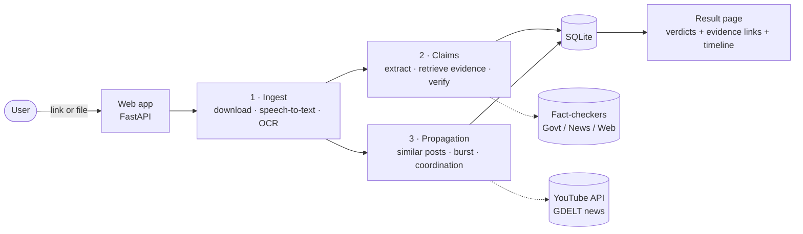

# Project Brief: Link-Based Misinformation Verification & Propagation Tracker

**B.E. CSE (Data Science) Capstone · PEC Chandigarh · Team of 4 · October 2026**

> **In one sentence:** a user pastes a link to a social-media post. The system downloads it, turns its speech and
> on-screen text into text, picks out the factual claims (numbers, dates, "according to…"), checks each claim
> against fact-checkers, government sources and news, **showing the evidence links**, and looks for signs that the
> same content is being pushed by many accounts in a short time.

---

## 1. Problem

Misinformation on Indian social media is mostly **video and images**, often in **Hindi or Hinglish**, and often built
around a **number or an attribution** ("₹4,100 crore", "WHO says…"). Numbers make false claims look credible; this is
the *numeric-truth effect* cited by the CLEF CheckThat! 2025 numerical-claims task. Manual fact-checking does not
scale, and existing tools assume English text input.

## 2. What the system does

| Step | Input → Output | How (all open-source / free tier) |
|---|---|---|
| 1. Download | link → video / audio / image / text | yt-dlp, X public embed, article extractor |
| 2. Extract | media → transcript + on-screen text | faster-whisper (speech, Hindi/English); EasyOCR (Hindi/English) |
| 3. Find claims | text → atomic, checkable claims | rule tagger (numbers, dates, attributions) + LLM decomposition |
| 4. Find evidence | claim → ranked sources | Google Fact Check API, Indian fact-checker feeds, PIB, web/govt search; multilingual re-ranking |
| 5. Verdict | claim + evidence → label + citations | LLM restricted to the given evidence; offline NLI fallback; numeric cross-check |
| 6. Propagation | post → similar posts over time | YouTube + news search around the post's date; near-duplicate matching; burst and coordination detection |

**Verdict labels:** `supported` · `contradicted` · `conflicting` · `unverifiable`.
**Core rule, enforced in code:** a verdict other than `unverifiable` must cite at least one evidence URL.

## 3. Architecture at a glance

Four independent modules (one per team member) share a small set of data classes. Details are in
[architecture.md](architecture.md).

## 4. Key design decisions

| Decision | Why |
|---|---|
| **Research first, verified live** (9 Oct 2026) | Platform access changes often; every API and platform was tested from our machine before design ([research.md](research.md)) |
| **Only public content, no logins** | Ethics and platform terms. Instagram needs login, so it is marked *unsupported*, with an upload fallback |
| **Pretrained models only, no training** | Student-scale compute (CPU laptop); reproducible |
| **Evidence-first verdicts** | The LLM may only use retrieved evidence; "media repeating a claim" does not count as support |
| **Free tiers only** | Groq (LLM), Google Fact Check + YouTube APIs, Tavily search, GDELT. Every key is optional; the system degrades gracefully |
| **Explainable propagation** | Time-bucket burst statistics and a CooRTweet-style coordination rule instead of a black-box classifier |

## 5. Results (details: [evaluation.md](evaluation.md))

**Claim verification**: QuanTemp benchmark (SIGIR 2024; real numerical claims from 45 fact-checkers), zero-shot:

| Verifier | Answers given | Accuracy when answering | Macro-F1 when answering |
|---|---|---|---|
| Majority-class baseline | 100% | 56% | 0.24 |
| Offline NLI model | 23% | 41% | 0.36 |
| **LLM (Groq gpt-oss-120b)** | 26% | **56%** | **0.42** |

The system is deliberately conservative: it says *unverifiable* rather than guess. When it answers, its quality is in
the range of the published few-shot LLM baselines (GPT-4 0.37, gpt-3.5 0.47 macro-F1). Those baselines had to
answer every claim, so the comparison is indicative, not exact.

**Coordination detection**: synthetic benchmark, held-out seed: **precision 0.86, recall 0.95, F1 0.91**.

**End-to-end example**: a DD News clip of a PIB fact-check (42 s, Hindi + English):

| Extracted claim (from the tweet screenshot, via OCR) | Verdict |
|---|---|
| "Govt spent 300% more on G20 than the funds allocated" | **contradicted**, citing reports of the PIB fact-check |
| "₹990 Cr allocated in the Union Budget" | **supported**, citing Indian Express |
| "Govt actually spent over ₹4,100 Cr" | **unverifiable**: sources only repeat it |

Runtime: **182 s** on a CPU laptop, down from 722 s after profiling.

## 6. Engineering evidence

- **~2,700 lines** of Python across 4 modules; **41 automated tests**, all with network calls mocked.
- **Iterative debugging on real runs**, each fix with a regression test:
  - junk claims (bare dates, channel boilerplate)
  - circular evidence (the post citing itself)
  - "G20" being parsed as the number 20
  - the LLM treating repetition as proof
  - thread-safety bugs introduced by parallelisation
- **Profiling-driven 4× speed-up** (thread tuning, concurrency, embedding cache).
- **Tuned on one seed, reported on a held-out seed** for the propagation threshold.
- Source control on GitHub with descriptive commit history.

## 7. Limitations (details: [limitations.md](limitations.md))

- **Platform access is the main constraint:**
  - X search is paid, so it is not used.
  - Reddit needs an approved API app; Instagram needs login.
  - Propagation is therefore measured on YouTube and news only.
- **High abstention.** About 74% of benchmark claims come out *unverifiable*, and the "partly true / conflicting" class
  is weak (also the hardest class in the literature).
- **Organic vs coordinated.** A fast organic viral wave can look like coordination. The UI therefore says *"consistent
  with coordinated spreading (not proof)"*.
- **Deferred:** analysis of the original poster's account history (see future scope).

## 8. Document map

| Document | For |
|---|---|
| **OVERVIEW.md** (this file) | 5-minute summary |
| [architecture.md](architecture.md) | system design: components, data flow, data model, API, design decisions |
| [research.md](research.md) | literature and tool survey with verified links (papers 2024–2026, repos, API terms) |
| [evaluation.md](evaluation.md) | benchmark method, metrics, results, honest interpretation |
| [limitations.md](limitations.md) | limitations, ethics, future scope |
| [../README.md](../README.md) | setup and run instructions |
