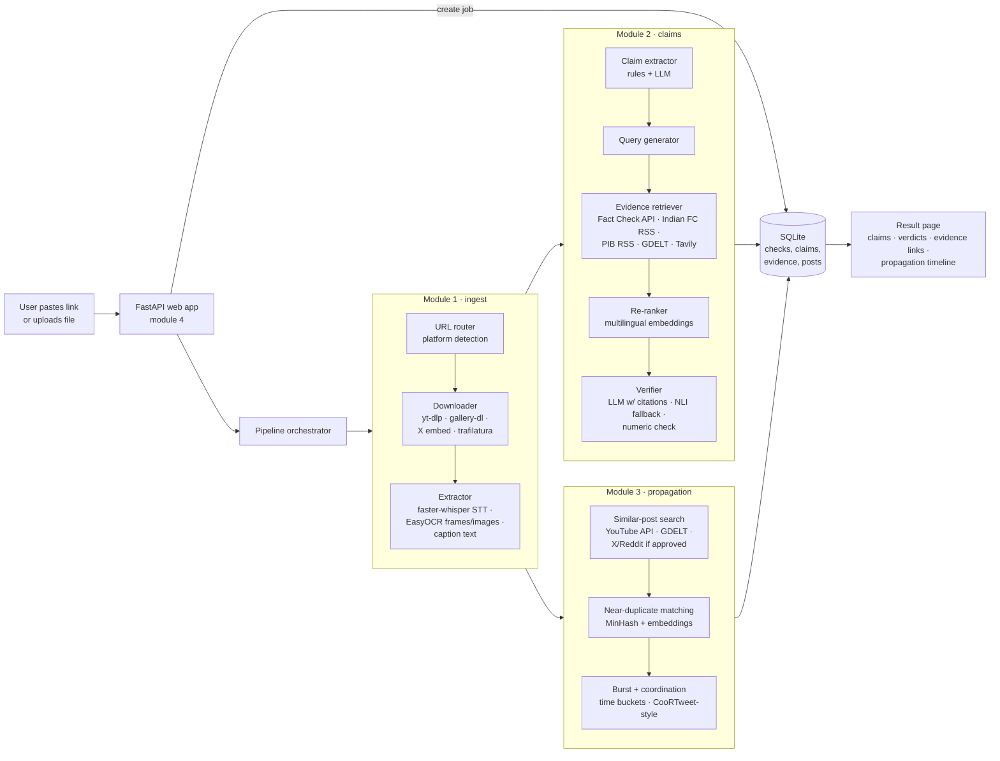

# Architecture (PROPOSED — awaiting team approval)

Based on findings in [research.md](research.md). Status: draft, 9 Oct 2026.

## 1. High-level diagram



## 2. Data flow (one check)

1. **Input** — URL (or uploaded file). Router identifies platform; unsupported platforms (Instagram) get a clear
   message + "upload the file instead" option.
2. **Download** to `data/media/<check_id>/` — video/audio/images + metadata (author, timestamp, caption, counts).
3. **Extract** → `ContentBundle { caption, transcript (lang, segments), ocr_lines, metadata }`.
4. **Claims** → list of `Claim { text_original, text_en, type: numeric|date|attribution|entity|other, source: caption|speech|ocr, spans }`.
5. **Evidence** per claim → `Evidence { url, source_type: factcheck|govt|news|web, title, snippet, published, score }`.
6. **Verdict** per claim → `{ label: supported|contradicted|conflicting|unverifiable, rationale, cited_evidence_ids, confidence }`.
   Code-level guard: label ≠ unverifiable requires ≥1 cited evidence URL.
7. **Propagation** → `{ matches: [Post], timeline buckets, burst_score, distinct_authors, coordination_clusters, flag }`.
8. Saved to SQLite; result page renders; JSON also available at `/api/checks/{id}`.

Jobs run in a background thread (FastAPI `BackgroundTasks`); the result page polls a status endpoint, showing
progress per stage.

## 3. Folder layout (one owner per module)

```
app/                       # module 4 — FastAPI app, templates, static, orchestrator, db
  main.py  pipeline.py  db.py  templates/  static/
ingest/                    # module 1 — router, downloaders, STT, OCR
claims/                    # module 2 — extraction, retrieval, verification
propagation/               # module 3 — search, similarity, burst/coordination
common/                    # shared dataclasses, config (.env), LLM client wrapper
eval/                      # evaluation scripts + results
tests/                     # pytest per module (network calls mocked)
docs/
```

## 4. Tech choices

| Concern | Choice | Why |
|---|---|---|
| Web | FastAPI + Jinja2 + vanilla JS | async-friendly, auto OpenAPI docs, simple |
| DB | SQLite (stdlib `sqlite3`) | zero setup |
| Download | yt-dlp[default] + Deno + ffmpeg; gallery-dl; trafilatura | see research §1 |
| STT | faster-whisper `small` int8 (CPU) | Hindi+English, runs on laptop |
| OCR | EasyOCR `['hi','en']` | pip-only install on Windows |
| Embeddings | `intfloat/multilingual-e5-base` (or `-small` for speed) | Hindi/English, MIT |
| NLI fallback | `MoritzLaurer/mDeBERTa-v3-base-xnli-multilingual-nli-2mil7` | multilingual, no API |
| LLM | pending decision D1 (recommend Groq free tier) | |
| Near-dup | datasketch MinHash + embeddings | |

## 5. Open decisions
See research.md §8 (D1 LLM, D2 X content, D3 Reddit app, D4 framework).
