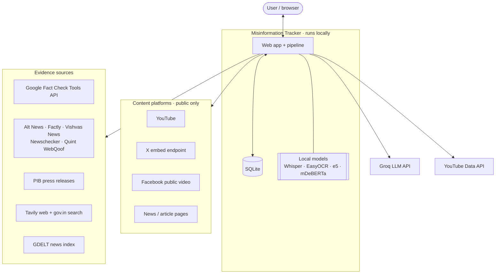
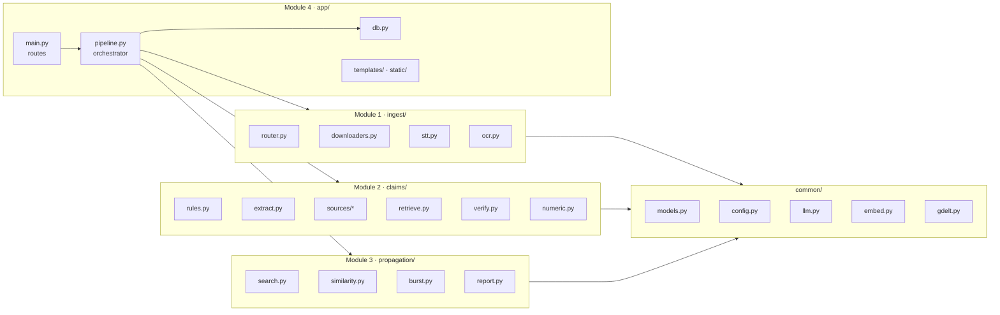
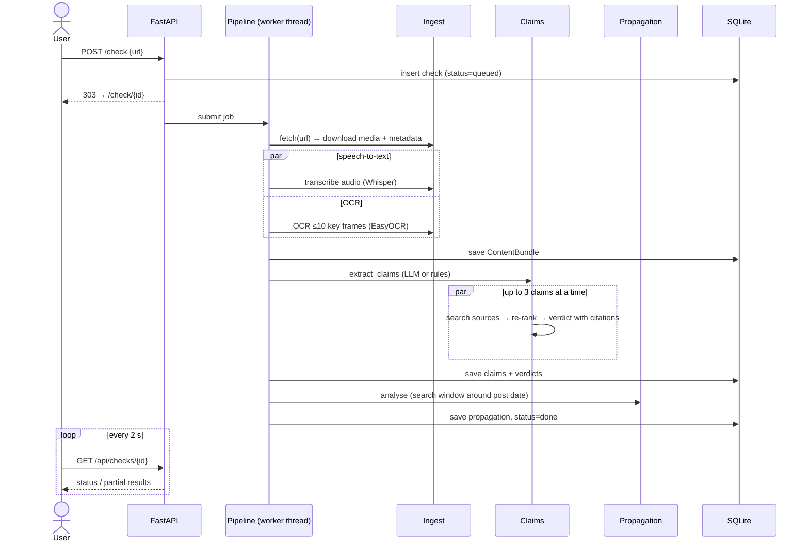
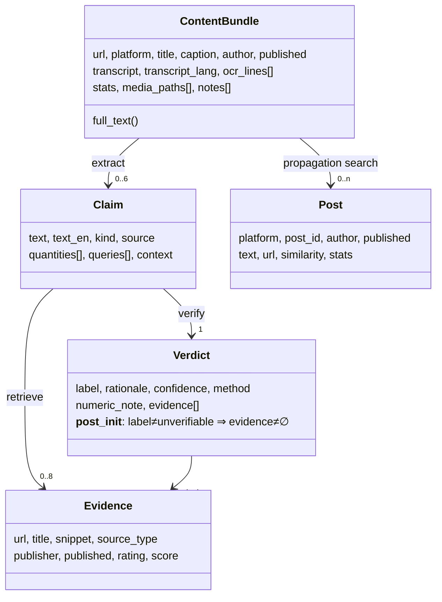
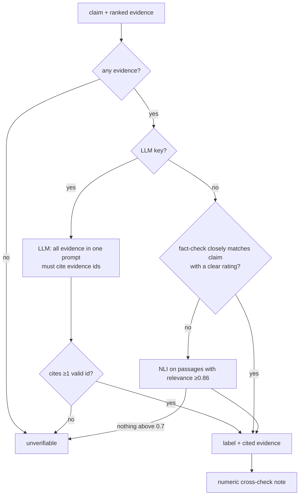

# System Architecture

**Status:** implemented (MVP) · **Last updated:** 9 Oct 2026 · Related: [OVERVIEW](OVERVIEW.md) ·
[research](research.md) · [evaluation](evaluation.md) · [limitations](limitations.md)

Each section starts with a one-line summary (**▸**) followed by the technical detail.

---

## 1. Goals and constraints

▸ *Check claims in public social-media posts with cited evidence, and flag suspicious spreading, on a student laptop
using only free services.*

| Requirement | How it is met |
|---|---|
| R1 Accept a link from any major platform | URL router with per-platform support level; upload fallback for unsupported platforms |
| R2 Handle video, audio, images, text in **Hindi + English** | multilingual speech-to-text, OCR, embeddings, LLM |
| R3 Focus on checkable facts (numbers, dates, names, attributions) | rule tagger + LLM claim decomposition |
| R4 **Every verdict backed by evidence links** | enforced in the `Verdict` data class, not only in prompts |
| R5 Detect high-frequency posting by many accounts | time-bucket burst statistics + coordination clustering |
| R6 Store past checks | SQLite |
| C1 No GPU, no paid APIs, no logins | CPU-sized models; free tiers; public content only |
| C2 Four-person team | four loosely coupled modules with a shared data model |

---

## 2. System context

▸ *The system sits between the user and a set of public data sources; nothing requires a user account on any platform.*

---

## 3. Component view

▸ *Four modules, one owner each, communicating only through shared data classes in `common/`.*

| Module | Owner | Responsibility | Entry point |
|---|---|---|---|
| 1 Ingest | Member 1 | link → `ContentBundle` (caption, transcript, OCR, metadata) | `ingest.extract.fetch()`, `extract_text()` |
| 2 Claims | Member 2 | `ContentBundle` → `[Claim]` → `[Evidence]` → `Verdict` | `claims.extract.extract_claims()`, `retrieve.find_evidence()`, `verify.verify()` |
| 3 Propagation | Member 3 | `ContentBundle` + claims → propagation report | `propagation.report.analyse()` |
| 4 App | Member 4 | web UI, job orchestration, storage, API | `app.main:app`, `app.pipeline.run()` |

---

## 4. Request lifecycle (sequence)

▸ *A check runs as a background job; the browser polls until it finishes and fills in results stage by stage.*

---

## 5. Data model

▸ *Five data classes carry everything between modules; one SQLite table stores each check, with stage outputs as JSON.*

**SQLite table `checks`:** `id`, `url`, `platform`, `status` (queued / running / done / error), `stage`,
`created_at`, `finished_at`, `content` (JSON), `claims` (JSON), `propagation` (JSON), `meta` (JSON: methods, sources,
timings), `error`. Any job left running when the server stops is marked *interrupted* on restart.

---

## 6. Module specifications

### 6.1 Module 1: Ingest (`ingest/`)

▸ *Get the post's content without logging in anywhere, then turn speech and on-screen text into text.*

| Platform | Method | Support |
|---|---|---|
| YouTube | yt-dlp (+ Deno JS runtime, required since yt-dlp 2025.11) | supported |
| X / Twitter | public embed endpoint (text, photos, counts) + yt-dlp for video | supported (content only) |
| Facebook | yt-dlp, public videos | partial |
| Reddit | oEmbed (title + author only); anonymous JSON returns HTTP 403 | partial |
| Instagram | requires login | unsupported → upload |
| Other pages | yt-dlp, else article text (trafilatura) | supported |

| Stage | Tool | Key parameters | Measured cost (42 s clip) |
|---|---|---|---|
| Download | yt-dlp | ≤480p single file, ≤600 s duration | 4 s |
| Speech-to-text | faster-whisper `small`, int8, CPU | VAD on, beam 1, threads = physical cores, auto language | 39 s |
| OCR | EasyOCR `['hi','en']` | ≤10 frames spread evenly; skip a frame if its dHash differs by ≤10 bits; confidence ≥0.4 | ~55 s (runs alongside speech-to-text) |

### 6.2 Module 2: Claims (`claims/`)

▸ *Find the factual statements, search for evidence about each, and let the model judge only from that evidence.*

**Claim extraction** (after Loki, [arXiv 2410.01794](https://arxiv.org/abs/2410.01794)):
1. *Rule tagger* (`rules.py`) scores sentences for numbers (₹, %, lakh / crore, Devanagari digits), dates, attribution
   cues (EN + HI), and named entities. It drops opinions, questions, fragments and boilerplate. Its output is passed to
   the LLM as hints, and it is the fallback when no LLM is configured (top 3 claims).
2. *LLM decomposition* (`extract.py`) returns ≤6 atomic, self-contained claims. Each has an English normalisation, a
   type, the source (title / caption / speech / OCR), 1–2 search queries, and **context** (who made the claim, and
   whether the post is debunking it).

**Evidence retrieval** (`retrieve.py`, `sources/`): all sources are queried in parallel:

| Source | Type | Access |
|---|---|---|
| Google Fact Check Tools API | fact-check (ClaimReview, incl. Indian IFCN members) | free key |
| Alt News, Factly, Vishvas News search feeds | fact-check | public RSS |
| Newschecker, Quint WebQoof, PIB latest feeds | fact-check / govt | public RSS (cached 3 h) |
| Tavily web search, plus a gov.in / rbi / who-restricted search | web / govt | free key (1,000 / month) |
| GDELT DOC 2.0 | news | no key; used only without Tavily (rate limit 1 request per 5 s) |

The checked post itself is removed from the results (no circular evidence). Results are de-duplicated and
**re-ranked** by cosine similarity with `multilingual-e5-small`, with a small bonus for fact-check (+0.02) and govt
(+0.015) sources. Passages scoring under 0.80 are dropped; the top 8 are kept.

**Verification** (`verify.py`):

Prompt rules that came out of real runs:
- An article that only *reports* a claim is not support for it.
- A fact-check or official source outweighs repetition in the media.
- Credible sources that disagree → *conflicting*.

### 6.3 Module 3: Propagation (`propagation/`)

▸ *Search for the same content around the post's date, then ask: did many different accounts post it within minutes of
each other?*

1. **Search window:** from 7 days before to 30 days after the post's publish date (last 90 days if the date is
   unknown). Sources: YouTube Data API (`search.list`) and GDELT news.
2. **Matching** (`similarity.py`): MinHash Jaccard on character 4-grams **≥0.5**, *or* multilingual-e5 cosine
   **≥0.87**, against the title, caption and top claims. The first catches copy-paste; the second catches paraphrase
   and translation.
3. **Burst** (`burst.py`): matches counted in 6-hour buckets. Robust z-score of the peak bucket:
   z = 0.6745·(peak − median)/MAD.
4. **Coordination** (after CooRTweet, Righetti & Balluff 2025): two *different* accounts are linked when they post
   near-identical content (Jaccard ≥0.8) within **10 minutes**. Connected groups of ≥3 accounts are flagged. The window
   was tuned from 60 to 10 minutes on synthetic data and checked on a held-out seed ([evaluation.md](evaluation.md)).
5. **Assessment:**

| Level | Rule | Wording shown |
|---|---|---|
| insufficient | fewer than 3 matches | not enough data |
| high | ≥1 coordination group | "consistent with coordinated spreading (not proof)" |
| elevated | z ≥ 3.5 and ≥5 accounts in the peak window | unusual burst |
| moderate | z ≥ 2 | some clustering |
| low | otherwise | no unusual spread |

### 6.4 Module 4: Web app (`app/`)

▸ *A small server-rendered website plus a JSON API; one job runs at a time because the models are CPU-heavy.*

| Method | Path | Purpose |
|---|---|---|
| GET | `/` | link form, platform support table, configured services, recent checks |
| POST | `/check` | submit a URL → redirect to the result page |
| POST | `/upload` | submit a media file (+ optional caption), the fallback for unsupported platforms |
| GET | `/check/{id}` | result page: post, claims, verdicts with evidence, propagation charts (polls while running) |
| GET | `/history` | past checks |
| GET | `/api/checks/{id}` | full JSON result |
| GET | `/api/health` | which services are configured (booleans only) |
| GET | `/docs` | auto-generated OpenAPI documentation |

---

## 7. Runtime and performance

▸ *Runs on one Windows laptop (16 logical cores, no GPU); a 42-second video takes about 3 minutes end to end.*

| Optimisation | Effect (measured) |
|---|---|
| Whisper threads = physical cores (8) instead of the default 4 | speech-to-text 59 s → 39 s (16 threads was slower: 77 s) |
| Speech-to-text and OCR run concurrently | extraction 229 s → 75 s |
| OCR capped at 10 evenly spread frames with near-duplicate frame skipping | OCR from ~10 min to ~55 s |
| Embeddings cached per text | re-ranking ~12 s per claim → under 1 s after the first claim |
| Claims verified 3 at a time | claim stage 436 s → 38 s |
| **Total** | **722 s → 182 s** |

Free-tier budgets per check (approximate): Groq ≈ 1 call for extraction + 1 per claim (~850 tokens each);
Tavily 2 searches per claim; YouTube 101 quota units (search + statistics) of 10,000 per day.

---

## 8. Design decisions (ADR summary)

| # | Decision | Alternatives considered | Reason |
|---|---|---|---|
| D1 | Groq free-tier LLM, offline NLI fallback | Gemini free tier; local Ollama | free, fast, no card; Gemini free limits low; local LLM too slow on CPU |
| D2 | X via public embed + yt-dlp, no X search | paid X API ($0.005 per read) | no paid APIs; propagation on X becomes future scope |
| D3 | Reddit partial (oEmbed) | Reddit OAuth app | manual approval required since Nov 2025; team chose not to apply |
| D4 | FastAPI + Jinja2 + SQLite | Flask; React SPA | background jobs, OpenAPI docs, minimal frontend build |
| D5 | Rules + LLM for claim extraction | fine-tuned check-worthiness model | no Hindi check-worthiness model found; no training budget |
| D6 | Evidence passed jointly to the LLM, with forced citations | per-passage verification | the survey ([arXiv 2407.02351](https://arxiv.org/abs/2407.02351)) reports joint prompting works better |
| D7 | Explainable propagation statistics | graph neural network | no labelled cascade data available for free; must be explainable |
| D8 | Deno and ffmpeg installed via pip | system installers | reproducible setup, no admin rights needed |

---

## 9. Reliability, security and ethics

- **Graceful degradation:** every external key is optional. Failed sources are logged and skipped. LLM failure →
  rule / NLI fallback. GDELT: rate-limit lock, back-off and a 1-hour cache.
- **No credentials for platforms:** no logins, no cookies, no CAPTCHA solving; public content only.
- **Secrets:** API keys live only in a git-ignored `.env`; `/api/health` exposes booleans, never key values.
- **Cautious output:** verdict confidence shown; propagation wording avoids accusations; footer warns that automated
  verdicts can be wrong.
- **Testing:** 41 offline tests (network mocked) including regressions for every bug found in real runs.
